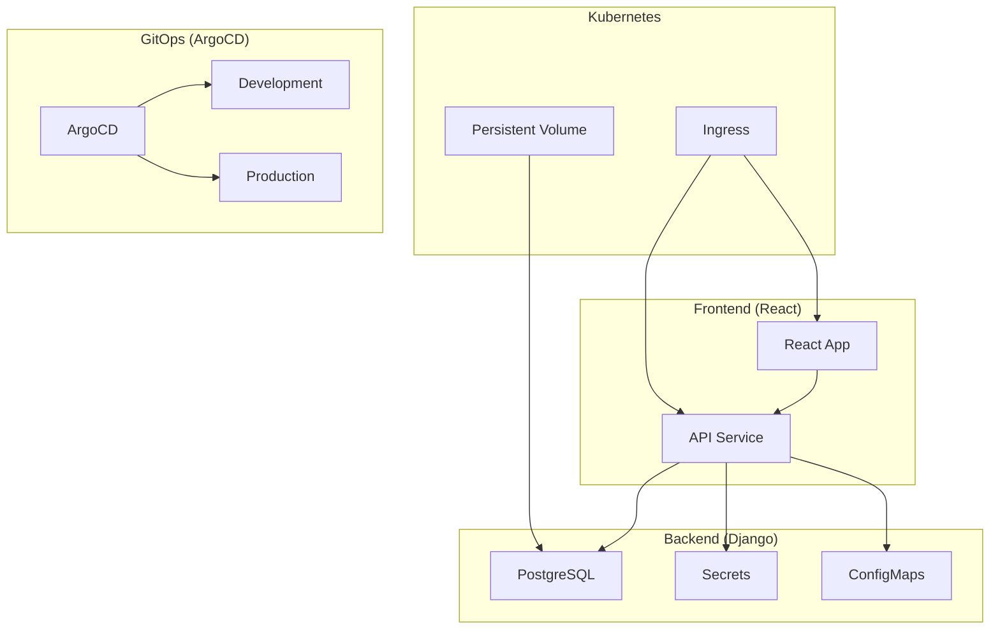
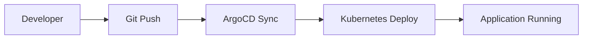

# DevOps Red Line


## ☁️ Two deployment targets

| Target | Stack | Where |
| --- | --- | --- |
| **AWS** | CDK (TypeScript): ECS Fargate, ALB, RDS PostgreSQL, Secrets Manager, KMS, Lambda, Amazon Bedrock, GitHub Actions with OIDC | [`infra/`](infra/README.md) |
| **Kubernetes** | Kustomize dev/prod overlays, Argo CD GitOps, Jenkins CI with SonarQube | [`manifests/`](manifests/), [`argocd/`](argocd/), [`Jenkinsfile`](Jenkinsfile) |

See [infra/README.md](infra/README.md) for the AWS architecture diagram, cost estimate, and deploy/teardown steps.

## 🚀 Project Description

**DevOps Red Line** is a modern, cloud-native web application that demonstrates comprehensive DevOps practices and GitOps deployment workflows. This project showcases a full-stack application with automated deployments, environment-specific configurations, and production-ready Kubernetes manifests.

### ✨ Key Features

- **🔧 Backend**: Django REST API with environment-aware configuration
- **🎨 Frontend**: React SPA with runtime environment variable injection  
- **🗄️ Database**: PostgreSQL with persistent storage
- **☁️ Cloud-Native**: Kubernetes deployments with Ingress and ConfigMaps
- **🔄 GitOps**: ArgoCD-ready with development and production overlays
- **🐳 Containerized**: Multi-stage Docker builds for optimized images
- **🔒 Secure**: Environment variables, secrets management, and security best practices
- **📊 Monitoring**: Health checks, resource limits, and observability-ready

## 🏗️ Architecture



## 🛠️ Tech Stack

| Technology      | Version | Description                       |
|-----------------|---------|-----------------------------------|
|  | 3.12+ | Backend programming language |
|  | 5.2 | Web framework with DRF |
|  | 18+ | Frontend JavaScript library |
|  | 5+ | Frontend build tool |
|  | Latest | Production database |
|  | 1.28+ | Container orchestration |
|  | Latest | GitOps deployment |
|  | Latest | Containerization |
|  | Latest | Ingress controller |

## 🚀 Quick Start

### Prerequisites

- Docker & Docker Compose
- Kubernetes cluster (local or cloud)
- kubectl configured
- ArgoCD installed (optional, for GitOps)

### 🐳 Local Development (Docker Compose)

1. **Clone and setup**:
   ```bash
   git clone https://github.com/kalah26/devops_red_line.git
   cd devops_red_line
   
   # Copy environment template
   cp .env.example .env
   # Edit .env with your local settings
   ```

2. **Start the application**:
   ```bash
   docker-compose up -d
   ```

3. **Access the application**:
   - Frontend: `http://localhost:3000`
   - Backend API: `http://localhost:8000/api`
   - Admin Panel: `http://localhost:8000/admin`

### ☸️ Kubernetes Deployment

#### Option 1: Direct Deployment
```bash
# Deploy to development environment
kubectl apply -k manifests/overlays/development/

# Or deploy to production environment  
kubectl apply -k manifests/overlays/production/
```

#### Option 2: GitOps with ArgoCD
```bash
# Deploy ArgoCD project and applications
kubectl apply -f argocd/project.yml
kubectl apply -f argocd/application-dev.yml
kubectl apply -f argocd/application-prod.yml
```

### 📊 Environment Variables

The application uses environment-specific configuration:

Secrets are **not stored in git**. Create them in the cluster before the first Argo CD sync:

```bash
# Create postgres-credentials and django-secret (Django key is generated)
POSTGRES_PASSWORD='<strong-password>' ./create-secrets.sh <namespace>

# Rotate the Django secret key later
./generate-django-secret.sh <namespace>

# Check configuration
kubectl kustomize manifests/overlays/development/
```

## 📁 Project Structure

```
devops_red_line/
├── 📂 Backend/                    # Django REST API
│   ├── 📂 odc/                   # Django project
│   │   ├── 📂 odc/               # Settings & configuration  
│   │   └── 📂 profiles/          # User profiles app
│   └── 📄 dockerfile             # Multi-stage backend build
├── 📂 Frontend/                   # React SPA
│   ├── 📂 src/                   # React source code
│   │   ├── 📂 components/        # Reusable components
│   │   ├── 📂 pages/             # Page components
│   │   └── 📂 services/          # API services
│   ├── 📄 dockerfile             # Multi-stage frontend build
│   └── 📄 docker-entrypoint.sh   # Runtime env injection
├── 📂 manifests/                  # Kubernetes manifests
│   ├── 📂 base/                  # Base Kubernetes resources
│   │   ├── 📂 backend/           # Backend deployment & service
│   │   ├── 📂 frontend/          # Frontend deployment & service  
│   │   ├── 📂 database/          # PostgreSQL resources
│   │   ├── 📄 configmaps.yml     # Application configuration
│   │   └── 📄 ingress.yml        # Ingress routing
│   └── 📂 overlays/              # Environment-specific configs
│       ├── 📂 development/       # Dev environment
│       └── 📂 production/        # Prod environment
├── 📂 argocd/                     # GitOps configuration
│   ├── 📄 project.yml            # ArgoCD project
│   ├── 📄 application-dev.yml    # Dev application
│   └── 📄 application-prod.yml   # Prod application
├── 📂 terraform/                  # Infrastructure as Code
├── 📄 compose.yml                # Docker Compose setup
├── 📄 .env.example              # Environment template
└── 📄 .gitignore                 # Comprehensive gitignore
```

## 🔧 Configuration Management

### Environment Variables

- **Backend**: Configured via ConfigMaps and Secrets
- **Frontend**: Runtime injection with `docker-entrypoint.sh`
- **Database**: Credentials managed via Kubernetes Secrets

### Key Configuration Files

| File | Purpose |
|------|---------|
| `manifests/base/configmaps.yml` | Application settings |
| `manifests/base/django-secret.example.yml` | Shape of the Django secret (template only) |
| `manifests/base/database/postgres-secret.example.yml` | Shape of the database secret (template only) |
| `create-secrets.sh` | Creates the real secrets in the cluster |
| `.env.example` | Local development template |

## 🌍 Environments

### Development Environment
- **Namespace**: `default`
- **Features**: Debug enabled, auto-sync with ArgoCD
- **Access**: `http://devops-red-line.local`
- **Database**: Shared PostgreSQL instance

### Production Environment  
- **Namespace**: `devops-red-line-prod`
- **Features**: Security hardened, manual deployments
- **Access**: `https://devops-red-line-prod.example.com`
- **Database**: Dedicated PostgreSQL with backups

## 🔄 Deployment Workflows

### GitOps Flow (Recommended)


### Manual Deployment
```bash
# Test configuration
kubectl kustomize manifests/overlays/development/

# Deploy to cluster
kubectl apply -k manifests/overlays/development/

# Monitor deployment
kubectl get pods,svc,ingress
```

## 📊 Monitoring & Observability

### Health Checks
- **Database**: `pg_isready` probe
- **Backend**: Django health endpoint  
- **Frontend**: Nginx status

### Resource Management
- **CPU**: Request/limit configured per service
- **Memory**: Optimized for each component
- **Storage**: Persistent volumes for database

### Logging
```bash
# View application logs
kubectl logs -f deployment/backend
kubectl logs -f deployment/front-app
kubectl logs -f deployment/postgres
```

## 🔒 Security Features

- ✅ **Secrets Management**: Kubernetes secrets created out-of-band (`create-secrets.sh`), never committed; ready for Sealed Secrets / External Secrets
- ✅ **Network Policies**: Ingress-controlled access
- ✅ **Resource Limits**: Prevent resource exhaustion
- ✅ **Health Checks**: Automated health monitoring
- ✅ **Image Security**: Multi-stage builds with minimal base images
- ✅ **Environment Separation**: Isolated dev/prod environments

## 🛠️ Development

### Local Development Setup

1. **Backend Setup**:
   ```bash
   cd Backend/odc
   python -m venv venv
   source venv/bin/activate
   pip install -r requirements.txt
   python manage.py migrate
   python manage.py runserver
   ```

2. **Frontend Setup**:
   ```bash
   cd Frontend
   npm install
   npm run dev
   ```

### Building Images

```bash
# Build backend image
docker build -t devops-red-line/backend:latest Backend/

# Build frontend image  
docker build -t devops-red-line/frontend:latest Frontend/
```

## 🚀 CI/CD Integration

### Jenkins Pipeline
- Automated builds on git push
- Run tests and security scans
- Build and push Docker images
- Update ArgoCD applications

### GitHub Actions (Future)
- Automated testing
- Security scanning
- Multi-environment deployments

## 🤝 Contributing

We welcome contributions! Please follow these steps:

1. **Fork the repository**
2. **Create a feature branch**: `git checkout -b feature/amazing-feature`
3. **Make your changes** and test thoroughly
4. **Update documentation** as needed
5. **Commit your changes**: `git commit -m 'Add amazing feature'`
6. **Push to your branch**: `git push origin feature/amazing-feature`
7. **Create a Pull Request**

### Development Guidelines

- Follow PEP 8 for Python code
- Use ESLint for JavaScript code
- Write tests for new features
- Update documentation
- Use conventional commit messages

## 📚 Documentation

- [Environment Configuration](ENVIRONMENT-CONFIG.md) - Detailed environment setup
- [ArgoCD Deployment](README-ArgoCD.md) - GitOps deployment guide
- [API Documentation](Backend/odc/README.md) - Backend API reference
- [Frontend Guide](Frontend/README.md) - Frontend development guide

## 🆘 Troubleshooting

### Common Issues

**Database Connection Issues**:
```bash
kubectl exec -it deployment/backend -- python manage.py dbshell
```

**Frontend Build Issues**:
```bash
kubectl logs deployment/front-app
kubectl exec -it deployment/front-app -- cat /usr/share/nginx/html/env-config.js
```

**ArgoCD Sync Issues**:
```bash
argocd app diff devops-red-line-dev
argocd app sync devops-red-line-dev --force
```

## 📞 Support

For support and questions:
- Create an issue in this repository
- Contact the development team
- Check the troubleshooting section

---

**Built with ❤️ for the DevOps community**
