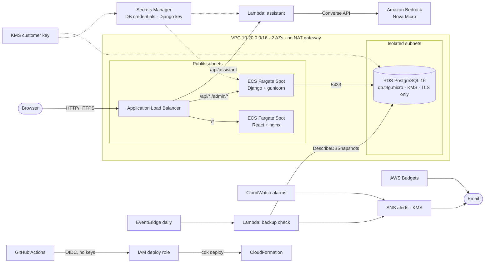

# DevOps Red Line on AWS (CDK, TypeScript)

The same Django + React app from this repo, deployed to AWS with the AWS CDK:
ECS Fargate behind an Application Load Balancer, RDS PostgreSQL, Secrets Manager
and KMS, a Bedrock-powered assistant on Lambda, and GitHub Actions deploying over
OIDC with no stored AWS keys.

## Architecture



## What it shows

| Area | How |
| --- | --- |
| Infrastructure as code | AWS CDK v2 in TypeScript, four stacks: `RedLine-Network`, `RedLine-Data`, `RedLine-App`, `RedLine-GitHubOidc` |
| Containers | Two ECS Fargate services (Spot), images built from this repo and pushed to ECR by `cdk deploy`, deployment circuit breaker with automatic rollback |
| Networking | ALB with path routing (frontend, API, Lambda); tasks accept traffic from the ALB only; database in isolated subnets with no internet route |
| Data | RDS PostgreSQL 16, encrypted with a customer-managed KMS key, TLS enforced (`rds.force_ssl`), 7-day automated backups, final snapshot on delete |
| Secrets | DB credentials and the Django `SECRET_KEY` generated in Secrets Manager and injected into containers at start; nothing in git or in task environment variables |
| IAM | Least privilege per role; `kms:Decrypt` only via Secrets Manager; Bedrock access scoped to one model; deploy role usable only from `main` of this repo |
| CI/CD | GitHub Actions: Django tests against PostgreSQL, CDK unit tests, `cdk synth` with cdk-nag, then `cdk diff` and `cdk deploy` over OIDC |
| Serverless | Assistant Lambda behind the ALB; scheduled Lambda that checks RDS backups |
| GenAI | `POST /api/assistant` calls Amazon Bedrock (Converse API). It verifies the app's own JWT first, so only signed-in users can spend tokens |
| Operations | CloudWatch alarms (5xx, unhealthy targets, DB CPU and storage, Lambda errors) to a KMS-encrypted SNS topic, VPC flow logs, ALB access logs, AWS Budgets alert |
| Compliance | [cdk-nag](https://github.com/cdklabs/cdk-nag) AwsSolutions pack runs on every synth; each accepted finding has a written reason in [`lib/nag-suppressions.ts`](lib/nag-suppressions.ts) |

## Deploy

Prerequisites: Node.js 22+, Docker, AWS CLI credentials for a sandbox account, and a region with Bedrock (for example `eu-west-1` or `us-east-1`).

```bash
cd infra && npm ci
npx cdk bootstrap                                   # once per account/region
npx cdk deploy RedLine-Network RedLine-Data RedLine-App -c alertEmail=you@example.com
```

The `AppUrl` output is the load balancer address. Confirm the SNS subscription email to receive alerts.

Options (pass with `-c key=value`):

| Context key | Default | Effect |
| --- | --- | --- |
| `alertEmail` | none | Email for alarms and the monthly budget (budget is created only when set) |
| `certificateArn` | none | ACM certificate: serves HTTPS on 443 and redirects HTTP |
| `bedrockModelId` | Nova Micro inference profile for the region | Any Bedrock model or inference profile ID |
| `monthlyBudgetUsd` | `15` | Budget limit (alerts at 80% actual and 100% forecast) |
| `useFargateSpot` | `true` | `false` runs on regular Fargate |

### Try the assistant

```bash
URL=<AppUrl>
curl -s -X POST $URL/api/register/ -H 'content-type: application/json' \
  -d '{"username":"demo","email":"demo@example.com","password":"Demo-pass-123"}'
TOKEN=$(curl -s -X POST $URL/api/login/ -H 'content-type: application/json' \
  -d '{"username":"demo","password":"Demo-pass-123"}' | jq -r .access)
curl -s -X POST $URL/api/assistant -H "authorization: Bearer $TOKEN" \
  -H 'content-type: application/json' -d '{"message":"How do I write a good profile?"}'
```

## Deploy from GitHub Actions (OIDC)

1. Create the deploy role once: `npx cdk deploy RedLine-GitHubOidc`
   (add `-c githubOidcProviderArn=<arn>` if the account already has the GitHub OIDC provider).
2. In the GitHub repo, add variables (Settings → Secrets and variables → Actions → Variables):
   `AWS_DEPLOY_ROLE_ARN` (stack output), `AWS_REGION`, and optionally `ALERT_EMAIL`, `CERTIFICATE_ARN`.
3. Create a GitHub environment named `aws` (add required reviewers if you want a manual approval).

Every push to `main` then runs the tests, `cdk diff` and `cdk deploy`. The role can only be assumed
from `main` of this repository and can only assume the CDK bootstrap roles.

## Cost

Rough on-demand estimate for `eu-west-1`, running 24/7:

| Item | ~USD/month |
| --- | --- |
| Application Load Balancer | 18–20 |
| RDS db.t4g.micro + 20 GB gp3 | 15–16 |
| Public IPv4 addresses (ALB + 2 tasks) | ~15 |
| 2 Fargate Spot tasks (0.25 vCPU, 0.5 GB) | ~5 |
| KMS key, 2 secrets, alarms, logs | ~3 |
| Lambda, Bedrock (Nova Micro), S3 | < 1 at demo traffic |
| **Total** | **~$55–60 (about $2/day)** |

No NAT gateway (saves ~$32/month per AZ): tasks run in public subnets with a public IP, and their security
groups only accept traffic from the load balancer. The $15 budget is meant to warn you if the stack is left running.

## Tear down

```bash
npx cdk destroy RedLine-App RedLine-Data RedLine-Network
```

RDS keeps a final snapshot (delete it in the RDS console when no longer needed). The KMS key is scheduled for deletion after 7 days.

## Tests

```bash
npm run build   # type-check
npm test        # CDK assertions + assistant JWT verification
npm run synth   # synth with cdk-nag
```

## Next steps for production

- Multi-AZ RDS, deletion protection and Secrets Manager rotation for the DB password
- Private subnets with a NAT gateway or VPC endpoints instead of public task IPs
- WAF on the ALB, a Route 53 domain with ACM, and auto scaling on the services
- Run migrations as a one-off ECS task in the pipeline instead of at container start
